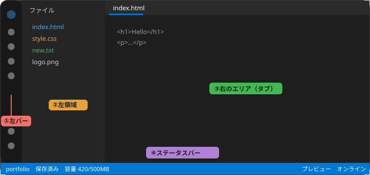

# はじめに：画面の見かた

このアプリは、部活のWebページを**ブラウザだけで編集・公開**するためのものです。

| 番号 | 場所 | 内容 |
|:-:|---|---|
| ① | 左バー | アイコンが並んだ列です。押すと、左領域に内容が出ます |
| ② | 左領域 | 左バーで選んだ内容が出ます。境目をドラッグすると幅を変えられます |
| ③ | 右のエリア | ファイルや各ページが**タブ**で開きます。**メイン**と**サブ**の2画面に分けられます（PC・タブレットはメインが左、サブが右） |
| ④ | ステータスバー | プロジェクト名・保存状態・行/列・言語・容量・接続状態・プレビュー・処理内容（PC・タブレットのみ） |

## 左バーのアイコン
| アイコン | 名前 | 使いみち |
|:-:|---|---|
| {icon:home} | ホーム | 右のエリアにホームを開きます。押している間だけ青くなり、離すと元に戻ります |
| {icon:inbox} | プロジェクト | 作る・開く・削除する |
| {icon:folder_open} | ファイル | ファイルとフォルダの一覧と操作 |
| {icon:search} | 検索 | プロジェクト全体の検索・置換、ファイル名検索 |
| {icon:history} | 履歴 | コミット・復元・分岐の確認 |
| {icon:share} | 共有 | 共有する相手と権限 |
| {icon:public} | 公開 | アプリの公開・更新 |
| {icon:apps} | ツール | 画像・音声・動画の変換 |
| {icon:help} | ヘルプ | このページ |
| {icon:admin_panel_settings} | 管理 | 管理者権限のある人だけに表示されます |
| {icon:data_usage} | 利用状況 | 容量の使われ方 |
| {icon:settings} | 設定 | 見た目・文字・エディター・通知 |
| {icon:person} | アカウント | 信頼端末・ログアウト |

> [!TIP] ホームボタンは「押すだけ」のボタンです
> ほかのボタンと違い、選択された状態にはなりません。押している間だけ青くなり、離すと元に戻ります。もう一度押すと、ホームを閉じてタブに戻ります。

## 左エリアを隠す（PC・タブレット）
いま選ばれている左バーのボタンを**もう一度押す**と、左エリアを隠せます。隠れている間は、どの左バーのボタンも押されていない状態になります。どれかのボタンを押すと、また表示されます。

> [!NOTE]
> 左エリアを隠しているときにホームを押しても、左エリアは隠れたまま、ホームだけが右に開きます。

## まずやってみること
1. {icon:inbox} プロジェクトで「新しいプロジェクト」を作る
2. {icon:folder_open} ファイルで `index.html` を作って編集する
3. 保存する（Ctrl/Cmd+S、または未保存タブの {icon:circle} を押す）
4. 「プレビュー」で表示を確認する

次は [プロジェクトとファイル](02-files.md) へ。
