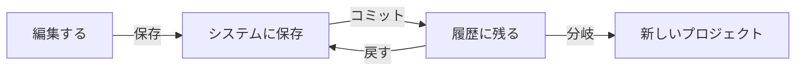

# 保存と履歴

保存には**2つの段階**があります。

## 1. 保存（システムに反映）
次のどれでも保存できます。

| 方法 | 場所 |
|---|---|
| Ctrl/Cmd+S | エディターで押す |
| {icon:save} 保存ボタン | タブ欄の右 |
| {icon:circle} を押す | 未保存のタブの {icon:circle} を押して「保存」 |
| 保存状態を押す | ステータスバーの「未保存／保存済み」 |

{blue}保存していない内容は、ページを閉じると失われます{/}。閉じようとすると確認が出ます。

## 2. コミット（戻れる地点を作る）
{icon:history} 履歴でメッセージを付けてコミットすると、その時点に**戻れる**ようになります。変更がないときは、コミットできません。

> [!NOTE]
> 戻せるのは、**コミットした時点まで**です。ファイルを保存していても、コミットしていない変更は履歴から戻せません。

- **戻す**：コミットのメニューから実行します。復元前に自動保存し、復元後の状態もコミットとして記録します
- **差分**：履歴の行を押すと、いまとの違いを右に表示します
- **分岐・公開**：関係図の印で、別プロジェクトへの分岐や公開の流れを確認できます

## 保存できないとき
保存しようとしたときに、次のポップアップが出ます（ポップアップの外を押しても閉じます）。

1. **他の人が先に保存したとき**：次の3つから選びます
   - **上書き**：自分の内容で置き換える
   - **再読み込み**：相手の内容を読み込む（自分の変更は退避されます）
   - **差分を見る**：違いを確認してから決める
2. **容量が上限に達しているとき**：「はい」を押して閉じ、大きいものや不要なアプリを整理します
3. **ロック中のとき**：しばらく待ってから、もう一度保存します

## 履歴を見る
履歴の一覧では、コミットごとに、親のコミットと、分岐した場所（**分岐点**・どこから分かれたか）が表示されます。

- **差分**：コミットを押すと、変更の内容が右に開きます。「まとめて」と「並べて」を切り替えられます。画像や音声などは、中身ではなく「変更あり」とサイズの変化（例：240KB → 251KB）を表示します
- **このコミットに復元**：復元前の状態を自動保存し、復元後に戻したコミットを示すメッセージで記録します
- **未追跡のファイル**：履歴の下に、履歴に入っていない大きなファイルが一覧になります
