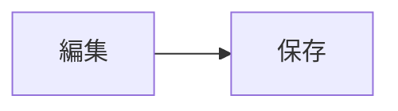

# 特殊Markdownの書き方

このページでは、VWCエディターのMarkdownプレビューとヘルプで使える書き方をまとめます。**標準的なMarkdown**に加えて、VWC独自の拡張（文字色・背景色・文字サイズ・アイコンなど）が使えます。

ヘルプの本文も `help/` フォルダの `.md` ファイルです。書き方はヘルプと同じです。

## ヘルプ項目の増減・並べ替え（ヘルプ編集時）

ヘルプの目次は `help/_index.md` で管理します。表示したいファイルを1行ずつ並べます。

~~~md
## 基本
- 01-start.md
- 02-files.md
~~~

| やりたいこと | 方法 |
|---|---|
| 項目を増やす | 新しい `.md` を作り、`_index.md` に1行追加 |
| 項目を減らす | `_index.md` からその行を消す |
| 並べ替える | `_index.md` の行の順番を変える |
| グループを作る | `## グループ名` の行を入れる |
| 反映する | ヘルプの左上の「ヘルプを再読み込み」を押す（サーバー経由で開いているとき） |

各ファイルの先頭に、タイトルとアイコン名（Material Symbols）を書けます。

~~~md
---
title: はじめに
icon: flag
---
# 本文の見出し
~~~

> [!NOTE] ファイルを直接開いているとき
> ブラウザの制限で `.md` を読み込めない場合は、`help/bundle.js` を使います。`.md` を書き換えたら、リポジトリで `python3 tools/complete.py` を実行して `help/bundle.js` を作り直してください。

---

## 標準Markdown

### 見出し
`#` の数で大きさが変わります（`#` が最大、`######` が最小）。見出しにはページ内リンク用のIDが付きます。

~~~md
# 見出し1
## 見出し2
### 見出し3
~~~

### 段落・改行
空行で段落を区切ります。行末に半角スペース2つ、または `\` を付けると、その位置で改行します。

### 強調・取り消し線・インラインコード
~~~md
**太字**、*斜体*、~~取り消し線~~、`インラインコード`
~~~

**太字**、*斜体*、~~取り消し線~~、`インラインコード`

### リンク
~~~md
[外部リンク](https://example.com)
[別のヘルプ/Markdownへ](01-start.md)
[ページ内の見出しへ](#見出し)
~~~

- `http(s):` のリンクは新しいタブで開きます。
- 同じ場所の `.md` ファイルへのリンクは、ヘルプ/プレビュー内で開きます（相対パス）。
- `javascript:` など危険なリンクは無効になります。`data:` は画像以外は無効になります。

### 画像
~~~md


~~~

`|` のあとに数字（px）を書くと、最大幅を指定できます。拡張子によって、動画・音声として埋め込まれる場合があります（後述）。

### 区切り線
`---` だけの行で、横線を引きます。

### 表
`|` で区切ります。2行目の `:--` `:-:` `--:` で、左・中央・右揃えを指定します。

~~~md
| 名前 | 数 | 備考 |
|:--|--:|:-:|
| りんご | 3 | OK |
~~~

### リスト
箇条書きは `-`、番号付きは `1.` です。入れ子にするときは字下げします。番号付きリストと箇条書きリストは、別のリストとして扱われます。

~~~md
- りんご
  - 青森産
- みかん

1. 最初
2. 次
   - 入れ子
~~~

### 引用
`>` で始める行は引用になります。

~~~md
> 引用文
~~~

---

## VWC独自の拡張

### 文字色
`{色名}…{/}` または `{#色コード}…{/}` で色を付けます。色名は `red` `orange` `yellow` `green` `blue` `purple` `pink` `cyan` `gray` です。テーマ（ダーク/ライト）に合わせて見やすい色になります。

~~~md
{red}赤{/} {blue}青{/} {#ff8800}色コード{/}
~~~

{red}赤{/} {blue}青{/} {#ff8800}色コード{/}

### 背景色
`{bg:色}…{/}` で背景色を付けます。色は色名または `#` から始まる色コードです。

~~~md
{bg:yellow}背景を黄色に{/}
~~~

{bg:yellow}背景を黄色に{/}

### 文字サイズ
`{size:150%}…{/}` のように、50%〜300%の範囲でサイズを変えられます。

~~~md
ふつう {size:150%}大きく{/} {size:80%}小さく{/}
~~~

ふつう {size:150%}大きく{/} {size:80%}小さく{/}

### アイコン（Material Symbols）
`{icon:アイコン名}` で Material Symbols アイコンを表示します。`{icon:名前|200%}` のように `|` のあとで50%〜300%のサイズ指定もできます。絵文字の代わりに使えます。

~~~md
{icon:home} ホーム {icon:save} 保存
大きく：{icon:home|200%} 色つき：{blue}{icon:public}{/}
~~~

{icon:home} ホーム {icon:save} 保存　/　大きく：{icon:home|200%}　色つき：{blue}{icon:public}{/}

アイコン名は [Material Symbols](https://fonts.google.com/icons) で確認できます（小文字と `_`）。

### 注釈（コールアウト）
引用の先頭行に `[!種類]` を書くと、色付きの囲みになります。種類は `NOTE` `INFO` `TIP` `WARNING` `DANGER` です（大文字小文字は区別しません）。`[!種類] タイトル` のようにタイトルも付けられます。**注釈と注釈の間には空行を入れてください。**

~~~md
> [!NOTE] メモ
> 本文

> [!WARNING] 注意
> 本文
~~~

> [!NOTE]
> メモの例です。

> [!INFO]
> 情報の例です。

> [!TIP] ヒントの例
> ヒントの本文です。

> [!WARNING] 注意の例
> 注意の本文です。

> [!DANGER] 危険の例
> 取り返しのつかない操作の前に使います。

### チェックリスト
`- [ ]`（未完了）`- [x]`（完了）で書きます。チェックボックスはクリックで切り替えられます。

~~~md
- [x] 完了
- [ ] 未完了
~~~

- ヘルプ内では、状態がこのブラウザに保存されます。
- Markdownファイルのプレビューでは、元の `.md` ファイルが書き換わります（未保存になるので保存してください）。

### コードブロック
言語名を付けるとシンタックスハイライトされます。右上の「コピー」で内容をコピーできます。

~~~md
```js
console.log('hello');
```
~~~

言語名 `mermaid` を指定すると、Mermaid図として描画します（必要なライブラリを読み込みます）。

~~~md

~~~


### 画像・動画・音声の埋め込み
`` の拡張子によって、自動的に画像/動画/音声として表示されます。`` で最大幅（px）を指定できます。

| 種類 | 拡張子 |
|---|---|
| 画像 | png / jpg / jpeg / gif / webp / svg など（通常の画像として表示） |
| 動画 | mp4 / webm / mov / m4v / ogv |
| 音声 | mp3 / wav / m4a / aac / ogg / oga / flac / opus |

ヘルプでは `help/` からの相対パス、MarkdownプレビューではそのMarkdownファイルからの相対パスで解決されます。

## 安全上の制限

> [!WARNING]
> 本文中のHTMLタグは、そのまま文字として表示されます（実行されません）。`javascript:` などの危険なリンク、画像以外の `data:` URL は無効になります。

## ページ内検索

ヘルプやMarkdownプレビューでも `Ctrl/Cmd+F`（またはタブ欄の {icon:find_in_page}）でページ内を検索できます。
