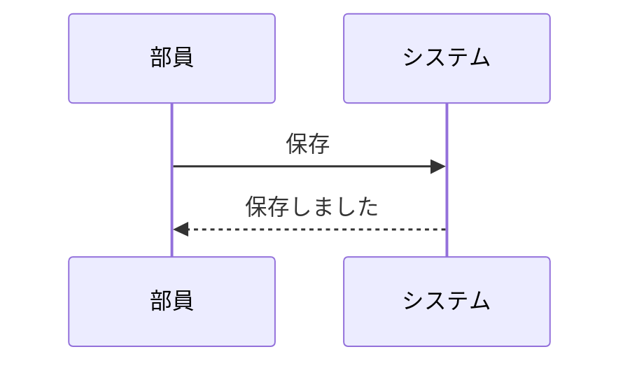
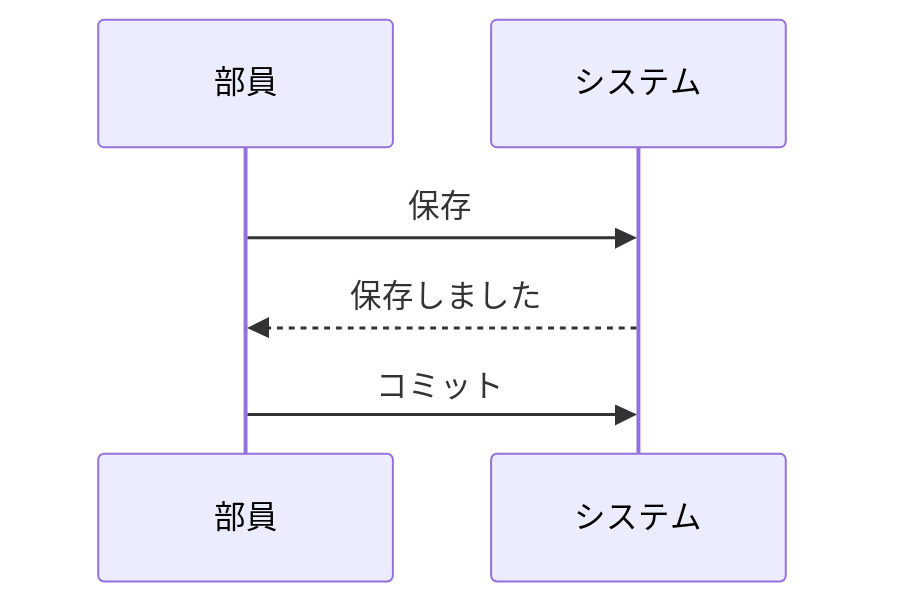
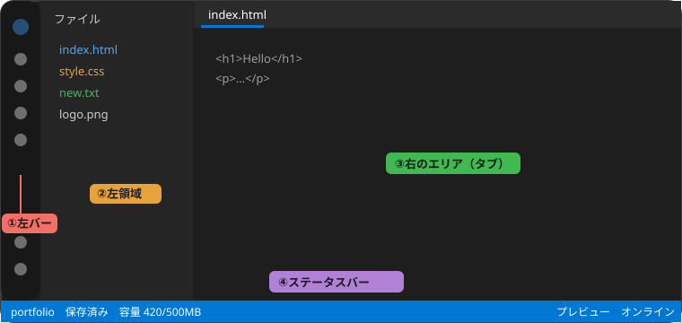

# このヘルプの書き方

ヘルプの本文は、`help/` フォルダの **Markdown（.md）ファイル**です。書き換えると、そのまま内容が変わります。この書き方は、**すべてのMarkdownプレビュー**でも同じように使えます。

## ファイルを増やす・減らす・並べ替える
目次ファイル `help/_index.md` に、表示したいファイルを1行ずつ並べます。

~~~md
## 基本
- 01-start.md
- 02-files.md
~~~

| やりたいこと | 方法 |
|---|---|
| 項目を増やす | 新しい `.md` を作り、`_index.md` に1行追加 |
| 項目を減らす | `_index.md` からその行を消す |
| 並べ替える | `_index.md` の行の順番を変える |
| グループを作る | `## グループ名` の行を入れる |
| 反映する | ヘルプの左上の「ヘルプを再読み込み」を押す（サーバー経由で開いているとき） |

各ファイルの先頭に、タイトルとアイコン名（Material Symbols）を書けます。

~~~md
---
title: はじめに
icon: flag
---
# 本文の見出し
~~~

> [!NOTE] ファイルを直接開いているとき
> ブラウザの制限で `.md` を読み込めない場合は、`help/bundle.js` を使います。`.md` を書き換えたら、次のコマンドで作り直してください。
>
> `python3 tools/complete.py`

---

## 書式の一覧

### 見出しと文字の大きさ
`#` の数で大きさが変わります（`#` が1つで最大、`######` が最小）。文中の一部は `{size:150%}…{/}` で変えられます。

~~~md
ふつうの文字と{size:150%}大きい文字{/}と{size:80%}小さい文字{/}
~~~

ふつうの文字と{size:150%}大きい文字{/}と{size:80%}小さい文字{/}

### 文字の色・背景
`{色}…{/}` で色、`{bg:色}…{/}` で背景色を付けます。色名は `red` `orange` `yellow` `green` `blue` `purple` `pink` `cyan` `gray`、または `#ff8800` のような色コードです。テーマ（ダーク／ライト）に合わせて見やすい色になります。

~~~md
{red}赤{/} {orange}橙{/} {yellow}黄{/} {green}緑{/} {blue}青{/} {purple}紫{/} {pink}桃{/} {cyan}水{/} {gray}灰{/}
{bg:yellow}背景を黄色に{/}　{#ff8800}色コードも使えます{/}
~~~

{red}赤{/} {orange}橙{/} {yellow}黄{/} {green}緑{/} {blue}青{/} {purple}紫{/} {pink}桃{/} {cyan}水{/} {gray}灰{/}
{bg:yellow}背景を黄色に{/}　{#ff8800}色コードも使えます{/}

**太字**、*斜体*、~~取り消し線~~、`インラインコード`、[リンク](https://example.com)、別のヘルプへのリンク（[はじめに](01-start.md)）も使えます。

### アイコン（Material Symbols）
`{icon:アイコン名}` で、画面に出ているものと同じアイコンを文中に入れられます。絵文字は使わず、この書き方を使ってください。

~~~md
{icon:home} ホーム　{icon:folder_open} ファイル　{icon:save} 保存
大きく：{icon:home|200%}　色つき：{blue}{icon:public}{/}
~~~

{icon:home} ホーム　{icon:folder_open} ファイル　{icon:save} 保存
大きく：{icon:home|200%}　色つき：{blue}{icon:public}{/}

アイコン名は [Material Symbols の一覧](https://fonts.google.com/icons)で調べられます（名前は小文字と `_` です）。`|` のあとの数字（%）で大きさを変えられます。

### 区切り線
`---` だけの行で、横線を引きます。

---

### 表
`|` で区切ります。2行目の `:--` `:-:` `--:` で、左・中央・右に寄せられます。

~~~md
| 名前 | 数 | 備考 |
|:--|--:|:-:|
| りんご | 3 | {green}OK{/} |
~~~

| 名前 | 数 | 備考 |
|:--|--:|:-:|
| りんご | 3 | {green}OK{/} |
| みかん | 12 | {red}在庫なし{/} |

### 注釈（色つきの囲み）
引用の最初の行に `[!種類]` を書きます。種類は `NOTE`（メモ）、`TIP`（ヒント）、`WARNING`（注意）、`DANGER`（危険）です。**注釈と注釈の間には、空の行を入れてください**（空の行がないと、1つの注釈につながります）。

~~~md
> [!TIP] タイトル
> 本文

> [!WARNING] 別の注釈
> 本文
~~~

> [!NOTE]
> メモの例です。

> [!TIP] ヒントの例
> ヒントの本文です。

> [!WARNING] 注意の例
> 注意の本文です。

> [!DANGER] 危険の例
> 取り返しのつかない操作の前に使います。

### リスト
**箇条書き**は `-`、**番号つき**は `1.` で書きます。入れ子にするときは、字下げします（番号つきの中の箇条書きは3文字、箇条書きの中は2文字ぶん下げます）。

~~~md
- りんご
  - 青森産
  - 長野産
- みかん

1. 最初にやること
2. 次にやること
   - 入れ子の箇条書き
3. 最後にやること
~~~

- りんご
  - 青森産
  - 長野産
- みかん

1. 最初にやること
2. 次にやること
   - 入れ子の箇条書き
3. 最後にやること

### チェックリスト
`- [ ]`（未完了）と `- [x]`（完了）で書きます。**チェックボックスは、押して切り替えられます**。ヘルプでは状態がこのブラウザに保存されます。Markdownのプレビューでは、押すと元のファイルが書き換わります（未保存になるので、保存してください）。

~~~md
- [x] 完了したこと
- [ ] まだのこと
~~~

- [x] 完了したこと
- [ ] まだのこと
- [ ] これも押してみてください

### コードブロック（色付け）
言語名を付けると、色が付きます。右上の「コピー」で全体をコピーできます。

~~~md
```js
const total = items.reduce((a, b) => a + b.price, 0);
```
~~~

```js
// 合計金額を計算する
const total = items.reduce((a, b) => a + b.price, 0);
console.log(`合計は${total}円です`);
```

```html
<!doctype html>
<h1 class="title">こんにちは</h1>
<script src="main.js"></script>
```

```python
def greet(name: str) -> str:
    return f"こんにちは、{name}さん"
```

言語名を付けない場合は、色なしの囲みになります。

```
色なしのコードブロック
```

### 図（Mermaid）
言語名に `mermaid` と書くと、図になります（初めて使うときに、ライブラリを読み込みます）。

~~~md

~~~



### 画像・動画・音声の埋め込み
`` の形で、拡張子によって自動で切り替わります。`|` に続けて数字を書くと、最大の幅（px）を指定できます。ファイルは `help/img/`、`help/media/` などに置き、`.md` からの相対パスで書きます。

~~~md


~~~


| 種類 | 拡張子 |
|---|---|
| 画像 | png / jpg / gif / webp / svg など |
| 動画 | mp4 / webm / mov / m4v / ogv |
| 音声 | mp3 / wav / m4a / aac / ogg / flac / opus |

> [!WARNING] 安全のための制限
> 本文中の HTML タグは、そのまま文字として表示されます（動作しません）。`javascript:` などのリンクは無効になります。

## ページ内検索
ヘルプでも `Ctrl/Cmd+F`（またはタブ欄の {icon:find_in_page} ）で、ページ内を検索できます。
